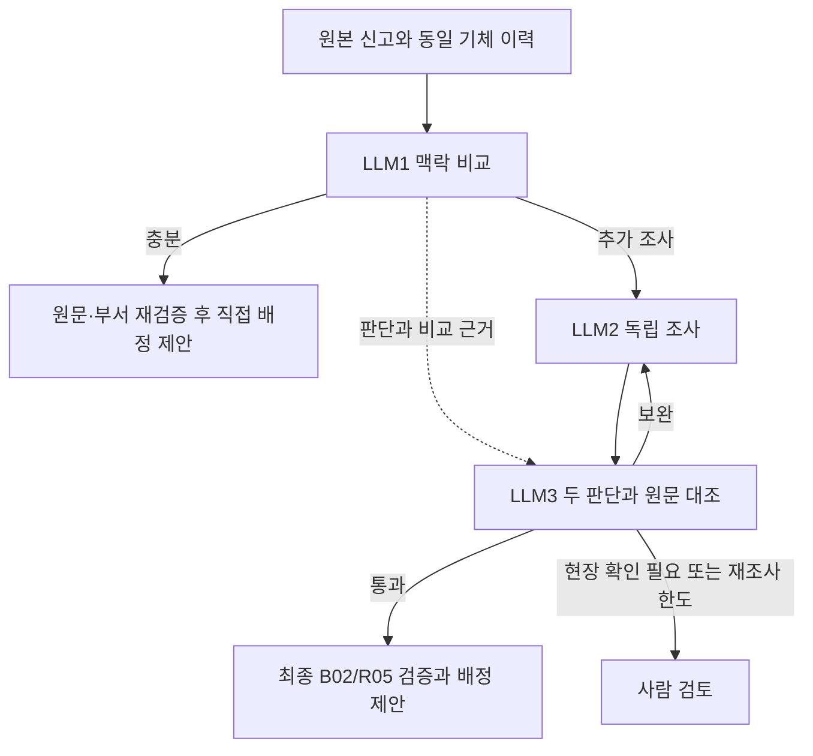

# 맥락 비교와 독립 조사·검토

2026-10-23 사용자 요청: LLM1의 공통 문자열 검사를 맥락 비교로 대체하고,
LLM1에서 조사로 넘긴 요청은 LLM2가 독립 판단한 뒤 LLM3가 두 결과와 원문을 검증한다.

## LLM1

증상에서 ATA 후보를 고르는 호출과 후보 ATA의 동일 기체 이력을 비교하는 호출을 유지한다.
기존 호출의 출력만 보강하며 별도의 의미 검증 모델 호출은 추가하지 않는다.

`LinkEvidence`는 현재/과거의 원문 인용, 대상, 현상, 두 관계(`SAME/RELATED/DIFFERENT/UNKNOWN`),
결함의 보고 여부(`PRESENT/ABSENT/UNCERTAIN`), 중요한 상충, 불확실성과 이유를 담는다.
같은 글자 표현은 필요하지 않으므로 한영 표현·동의어를 비교할 수 있다.
단계·위치·정도 완전 일치, 최소 이력 건수, 기간·유사도 임계값은 추가하지 않는다.

실행기는 각 원문 인용의 존재, 같은 기체·ATA, 양쪽의 긍정된 결함 현상,
관계의 양립, 중요 상충 부재와 현재 B03의 담당 ATA를 확인한다.
과거 인용은 `symptom` 또는 `symptom_text`에서 확인하며 조치에만 나온 단어로 대신하지 않는다.
검증되지 않은 연결이나 담당 범위 불일치는 직접 배정을 해제해 LLM2로 보낸다.
조회되지 않은 ID·부서, 권한·컨텍스트 오류는 기존 오류 경로를 유지한다.

**의미·부정 여부의 정확성은 여전히 모델 판단이다.** 원문 존재나 구조화된 관계 필드가
의미상 타당성을 증명하지 않는다. 모델이 잘못된 관계를 일관되게 출력할 가능성은 남는다.
직접 배정은 LLM3를 거치지 않으므로 직접 배정 오판율을 따로 평가해야 한다.

## LLM2

LLM2 노드는 `input_schema=InvestigatorState`로 등록한다. 입력 채널은 원본 접수 5필드,
`investigations`, `retry_count`, LLM2 전용 `llm2_context`뿐이다.
공용 `agent_context`, `classification`, `reviews`, `stage_events`는 노드에 전달되지 않는다.
따라서 LLM1의 수리이력 본문·ID·B02 조회 기록과 판단도 LLM2에 들어가지 않는다.

LLM2는 자체 B01/B03 조회로 요청 범위·부서를 확인하고 RAG 근거를 조회한다.
B02는 도구 목록과 실행 gateway에서 차단하며 HISTORY 인용도 거부한다.
`llm2_context`에는 LLM2가 직접 조회한 자료만 보존한다.
`merge_for_review` 노드가 LLM3 직전에만 공용 자료와 LLM2 자료를 합치고,
요청 ID·context_version·검색 범위·스냅샷이 다르면 합치지 않는다.
LLM1·LLM3와 최종 근거 검증의 B02 호출은 유지한다.

재조사도 같은 좁은 입력 스키마를 사용한다. LLM3 자유 서술 보완 질문에는 LLM1 이력이
섞일 수 있으므로 그대로 전달하지 않는다. 현재는 재조사 횟수와 고정된 독립 재검토 지시,
LLM2 자신의 이전 조사·RAG 자료를 사용한다. 구체적인 보완 과제 전달은 이력 비노출을
보장하는 구조화된 계약을 추가할 때 확장한다.
AMM은 최종 배정 후 전달하는 참조 정보다.

## LLM3

`assessments.llm1/llm2`는 공통 필드
`ata_chapter/proposed_department/rationale/evidence/sufficient/evidence_status`로 대조한다.
LLM1이 없거나 제안 부서가 null일 수 있다. LLM2의 `sufficient`는 null이다.
LLM1의 미검증 비교 설명은 가설이며, 실제 조회 원문과 구분한다.
근거 없는 초기 가설과 다르다는 사실만으로 재조사를 요구하지 않는다.
원문·현재 담당 범위로 다른 결론을 지지할 수 있으면 그 이유를 설명하고 통과할 수 있다.
`REFERENCES_VERIFIED`도 내용의 의미상 정확성을 보장하는 표시는 아니다.

내부 `ReviewAssessment.comparison`은 다음 상태와 이유·근거 ID를 담는다.

- `NOT_AVAILABLE`: LLM1 결과가 없는 독립 LLM2·3 실행.
- `CONSISTENT`: 두 판단이 양립한다. 동의 자체는 통과 근거가 아니다.
- `RESOLVED_DIFFERENCE`: 차이를 원문 근거로 해소했다.
- `UNRESOLVED_DIFFERENCE`: 중요한 차이가 남아 통과할 수 없다.

명시적인 ATA·부서 차이에 `CONSISTENT`를 쓰거나 미해결 상태로 PASS하면
실행기가 SUPPLEMENT로 바꾼다. 현재 부서의 담당 ATA와 조사안 ATA가 다를 때도 보완한다.
차이가 해소됐다면 LLM1과 다른 결론을 허용하며, 비교 근거는 최종 evidence에도 포함한다.
원인을 확정하거나 두 답 중 하나를 강제로 고르는 구조가 아니다.

## 계약·배포

공개 `Classification` 5필드, `Investigation`, `Review`, RabbitMQ 이벤트 형식은 유지한다.
내부 비교는 `AgentContext.classification_comparisons/review_comparisons`에만 저장한다.
권한·검색 스냅샷·컨텍스트 버전·요청별 토큰·최종 B02/R05 검증을 유지한다.
컨텍스트 무효화 때 비교 자료도 폐기한다. DB·MCP 서버의 스키마나 도구 계약 변경은 없다.

이력 공유 방식의 구버전 체크포인트를 이어 쓰지 않도록 실행 thread 접두사는
`llm123-isolated-v2` / `llm23-isolated-v2`로 분리한다. 배포 시 진행 중인 실행은 먼저 종료한다.
기존 checkpoint에 비교 자료가 없으면 LLM3는 원문 근거를 새로 검토해야 하며
과거 설명만으로 새 비교 검증이 완료됐다고 가정하지 않는다.
비교 자료가 없는 구버전의 직접 배정 checkpoint는 최종 검증에서 사람 검토로 전환한다.

## 검증과 비용

`tests/test_contextual_handoff.py`는 합성 모델로 번역 표현·부정·상충·조치 전용 인용,
LLM2 입력 분리, LLM3 충돌 처리와 최종 인용의 연결을 검사한다.
`tests/test_graph_isolation.py`는 실제 LangGraph 노드의 입력을 검사해 최초 실행·재조사·
체크포인트 재개에서 이력·판단 비전달, LLM3의 자료 수신과 버전 충돌 차단을 확인한다.
합성 테스트나 MCP 전송 테스트를 실제 모델 정확도로 보고하지 않는다.
실제 모델 평가는 직접 배정 오판율·불필요한 조사 전환율·최종 오배정률,
토큰·시간·재조사 횟수를 별도로 기록한다.
기존 200건은 LLM1을 거치지 않은 개발 평가이므로 전체 흐름의 성능을 보장하지 않는다.
추가 비교 출력·재조사에 따라 비용이 달라지며, 정확도 개선 수치는 아직 확정하지 않는다.

2026-10-23 개발 점검에서 실제 `gpt-5.4-mini`로 합성 LLM1 사례 8건을 실행했다.
동일/번역 증상·조건 누락 3건은 직접 제안, 부정·다른 현상·일반 표현·조치 전용 인용·
부서 담당 범위 불일치 5건은 조사로 전환해 8건의 기대 분기와 일치했다.
초기 LLM3 점검에서 근거 없는 LLM1 가설 때문에 불필요하게 재조사하는 사례를 발견해
근거 우선 규칙을 보강했다. 이후 휠·플랩·발전기·모호한 신고 4사례를 각 2회 확인해
앞의 세 사례는 근거로 차이를 해소하고, 모호한 사례는 통과시키지 않았다.
이는 같은 개발 과정의 소규모 점검이며 별도 검증셋의 성능 향상 수치가 아니다.
실제 모델을 사용했지만 MCP 응답은 합성 자료를 Python으로 제공했으며,
실제 agent 서버·공유 DB·RabbitMQ를 거친 새 버전의 전체 통합 평가는 포함하지 않는다.
